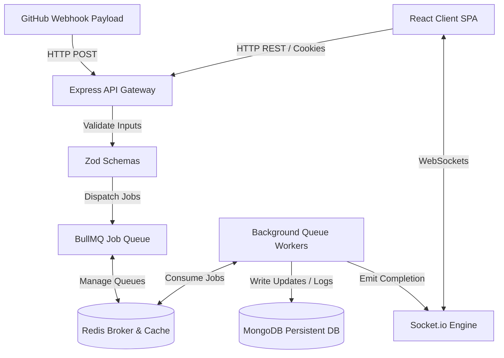

# NexaSetu Backend — Event-Driven Sprint Orchestration Server

NexaSetu Backend is an Express 5 API server and asynchronous worker engine. It ingests GitHub repository webhook streams, executes natural language project commands, and orchestrates sprint timelines using background worker queues.

---

## 🏗️ Architecture Design & Job Flow



---

## 📂 Backend Project Structure

```text
src/
├── config/             # Mongoose DB, IORedis, and environment configurations
├── controllers/        # Express request-response lifecycle handlers
├── models/             # Mongoose MDB schemas (Tasks, Projects, Sprints, AI Logs)
├── routes/             # RESTful API routing (versioned under /api/v1/)
├── services/           # Domain business logic (GitHub API wrappers, NLP parsers)
├── queues/             # BullMQ queue managers and worker thread handlers
├── middleware/         # Auth guard, CSRF/Helmet security, Zod input validation
├── validations/        # Strict Zod schemas for API payload validation
├── utils/              # Winston JSON Logger, error classes, date normalizers
├── jobs/               # Recurring cron timers (daily performance rollups)
├── socket.js           # Socket.io connection registries and namespace emitters
└── app.js              # Express app startup and middleware configurations
```

---

## ⚡ Asynchronous Job Queue & Worker Pipeline

To keep the main API thread responsive, heavy external operations (e.g., fetching repository metadata or processing AI sprint summaries) are offloaded to **BullMQ** workers backed by **Redis**:

- **Concurrency Control:** Configured to run `3` concurrent job consumers per process thread.
- **Retry Strategy:** Automatic exponential backoff retries with a `1000ms` initial delay and up to `5` retry attempts.
- **Failure Management:** Failed jobs are automatically moved to a "Failed" queue state and logged via a structured Winston logger for administrator auditing.
- **Webhook Buffer:** Webhook payloads from GitHub are acknowledged immediately (returning HTTP `202`) and queued for async ingestion to protect the server from transaction spikes during batch pushes.

---

## 📝 API Endpoints Reference

### 1. Magic Bar Command Execution
- **Endpoint:** `POST /api/v1/magic/execute`
- **Authentication:** Required (HTTP-Only Cookie JWT)
- **Request Payload:**
  ```json
  {
    "prompt": "/task create \"Refactor database index\" --assign alex",
    "projectId": "60d5ec49f83c2c5468d6ef2c"
  }
  ```
- **Success Response (`200 OK`):**
  ```json
  {
    "success": true,
    "action": "task_created",
    "data": {
      "id": "60d5ec49f83c2c5468d6ef8d",
      "title": "Refactor database index",
      "assignedTo": "alex",
      "status": "todo"
    }
  }
  ```

### 2. General Endpoints

| Route | Method | Auth | Payload | Description |
| --- | --- | --- | --- | --- |
| `/api/v1/auth/register` | `POST` | Public | `{ email, password, name }` | Register new user |
| `/api/v1/auth/login` | `POST` | Public | `{ email, password }` | Authenticate & set JWT cookie |
| `/api/v1/projects` | `GET` | Required | None | Fetch all synced projects |
| `/api/v1/tasks/:id` | `PATCH` | Required | `{ status, assigneeId }` | Update task details |
| `/api/v1/epi/metrics` | `GET` | Required | Query params: `?projectId` | Get PR velocity/code metrics |

---

## 🗄️ Database Schema & Indexing

The platform utilizes **MongoDB** via Mongoose to store hierarchical sprint and task dependencies:

- **Key Collections:**
  - `Workspace`: Top-level user container.
  - `Project`: References repository IDs and keeps sync status.
  - `Task`: Holds description, assignee, prerequisite tasks (for ReactFlow dependencies), and GitHub issue references.
  - `AILog`: Unstructured document store auditing natural language directives.
- **Index Strategies:**
  - `Compound Index` on `{ projectId: 1, status: 1 }` to optimize dashboard query filtering.
  - `Single-field Index` on `githubIssueId` to resolve webhook updates to internal task rows instantly.

---

## 🛠️ Architectural Trade-Offs

- **MongoDB vs PostgreSQL:** The project dependency graph and AI command audit logs are highly fluid and polymorphic. MongoDB's schema flexibility allows task objects to hold dynamic attributes and dependency arrays without migrations.
- **BullMQ vs Kafka:** The backend does not require high-throughput multi-consumer stream processing. BullMQ utilizes the existing Redis instance, keeping infrastructural complexity and operating costs low.
- **Express vs Fastify:** While Fastify yields slightly higher throughput, Express 5's middleware compatibility with **Socket.io** and established HTTP-only cookie wrappers allowed for more secure and rapid implementation.

---

## ⚙️ Setup & Deployment

### Environment Configuration
Create a `.env` file in the root backend directory:
```env
PORT=5000
MONGODB_URI=mongodb://localhost:27017/nexasetu
REDIS_URL=redis://localhost:6379
JWT_SECRET=your_jwt_signing_key
SUPABASE_URL=your_supabase_project_url
SUPABASE_KEY=your_supabase_anon_key
GITHUB_TOKEN=your_github_personal_access_token
```

### Docker Compose Local Setup
You can spin up local MongoDB and Redis instances using the included docker-compose file:
```yaml
version: '3.8'
services:
  mongodb:
    image: mongo:6.0
    ports:
      - "27017:27017"
    volumes:
      - mongo-data:/data/db

  redis:
    image: redis:7.0-alpine
    ports:
      - "6379:6379"

volumes:
  mongo-data:
```
Launch using:
```bash
docker-compose up -d
```

### Running Server
1. Install dependencies:
   ```bash
   npm install
   ```
2. Start development mode with hot-reloading:
   ```bash
   npm run dev
   ```
3. Start production server:
   ```bash
   npm run start
   ```
